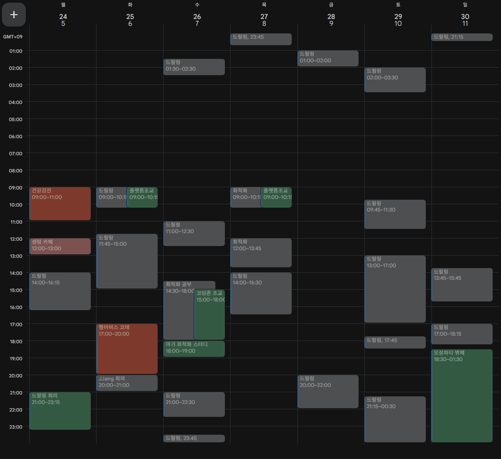
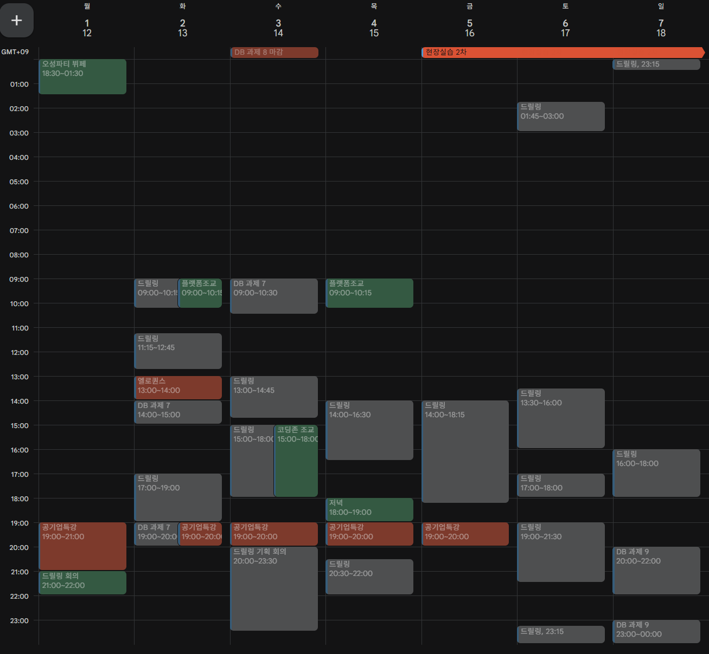

# 25년 12월 1주차를 돌아보며

---

저번 주 회고를 안 해서 이번 주는 2개를 같이 해야지.. 부지런히 하자!!

11월 4주차는 드릴링 개발 열심히 했다. 보면 중간에 빈 곳들이 있는데, 열심히 논 흔적일 것이다. 가족 여행을 갔던 기억이다.

이번 주 12월 1주차 계획 일정이다. 공기업도 챙기자 해서 공기업 특강 좀 저장해뒀고, 드릴링 개발으 열심히 했다. 보면 오전 시간이 쭉 비어있다. 늦게 일어나서 밥까지 챙겨먹으니 시간이 붕 떠버린다. 일찍 일어나서 일찍 씻고 밥 빨리 먹고 오전 시간도 쓰자…

본가에 꽤 있었는데 자취방 시디즈 T80이 그립더라… 자취방 오니 역시 좋다 이 의자. 올해 최고 만족하는 템은 누피 키보드랑 시디즈 의자라고 자신있게 말할 수 있다.

드릴링 개발만 열심히 하고 있다. 현장실습, 인턴쉽 다 떨어지고 내 게임 열심히 만들고 있다. 다른 프로그래머들은 시험 공부 이슈로 작업을 못하고 있고, 나랑 팀장님이 열심히 달리고 있다. 계속 열심히 해보자!

### TODO

- 드릴링 목표치까지 완성 이끌기
    - 결국 성공하고 루키 콘테스츠 냈지롱!! 고생하긴 햇어.
- 오픽 공부 5일 이상 하기
    - 뭐 다 떨어지고 한 학기 더 하는데 오픽은 내년에 해~

### KEEP

- 일찍 일어나기 → 개같이 실패
- 행복하게 살기 → 약간 애매한데 뭐 행복하긴 해

### QUESTION

Q. 오픽 공부 했지??? 안 했으면 그냥 아주 그냥

A. 너 지원한거 다 떨어져서 졸업 못해. 그냥 한 학기 더 해라 내년에 해 ~

# 25년 12월 2주차를 바라보며

---

### TODO

- 드릴링 개발 열심히 하기
- 시험 공부 열심히 하기

### KEEP

- 가은쓰한테 연락 잘하기

### QUESTION

Q. 시험 공부 빡세게 했제잉?