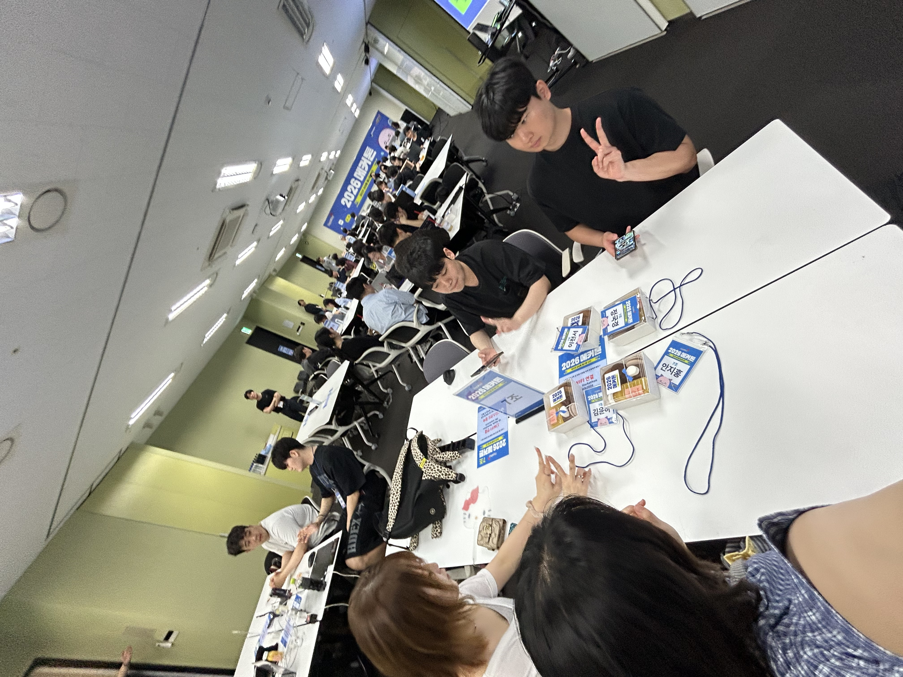
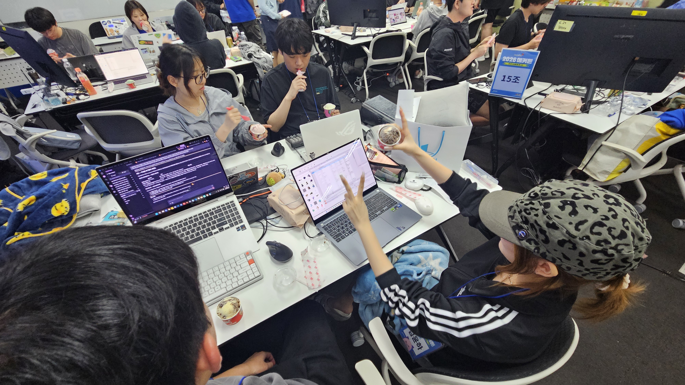
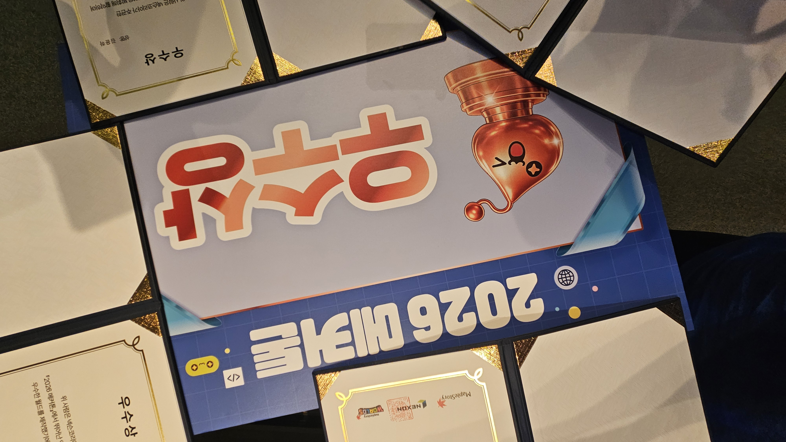
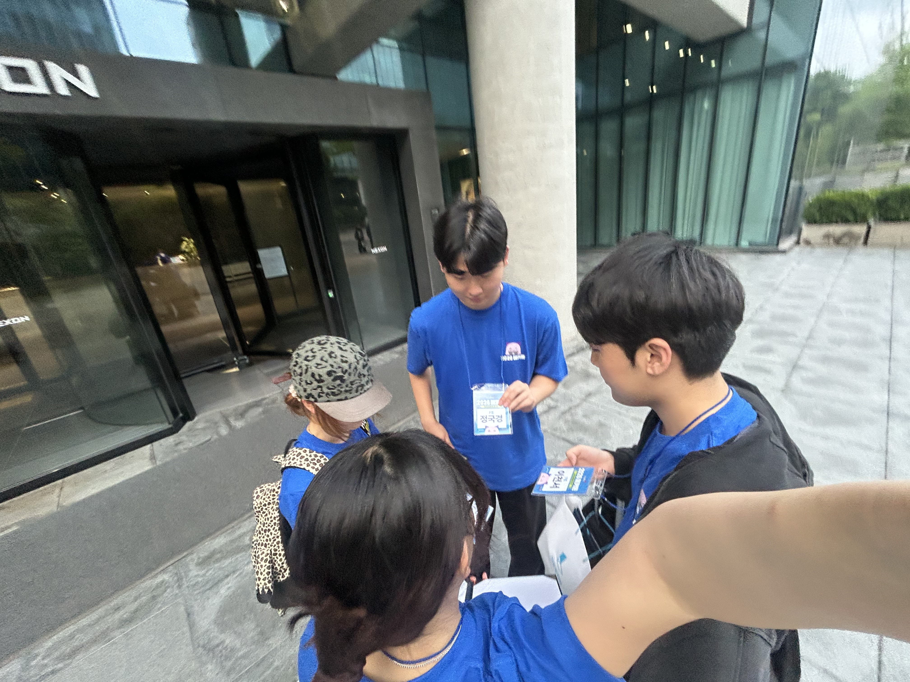

## 메커톤 후기

26.07.03 ~ 26.07.05 넥슨 메이플 해커톤에서 우수상을 탔다. 흐흐
원래 이런 거 잘 안 남기는데 기부니가 좋으니까 글로 좀 남겨보려 한다

## 신청

메커톤 홍보하는거 보고 바로 맨날 게임 만들던 사람들이랑 팀을 짜서 신청했다. 사실 팀 포폴 낼 때부터 이게 될까될까 했는데 진짜 돼버렸다..!! 미대 친구가 팀 포폴을 멋지게 만들어줘서 뽑아줬나? 아무튼 매우매우 기부니가 좋았다.

메커톤은 일정이 아래처럼 됨

> 오티/발대식 -> 온라인 멘토링(공통) -> 온라인 멘토링(직군) -> 메커톤
> 

### 오티/발대식

오티한다고 서울 갔다옴. 넥슨이여도 기차비는 안 주네. 후.. 그래도 넥슨이 부르면 가긴 해야지.
가서 뭐 아이스 브레이킹하고 원페이지 기획서도 작성해보고 했다.
아 그리고 상품도 많이 뿌렸는데 내가 발 빠르게 뭔가 해서 상품 2개나 따버림 흐흐
(주니어 예티 인형)
(곰돌이 후드)

일단 '커스터마이징 수집' 게임을 만드는 걸로 기획 일단락이 됨.

### 온라인 멘토링(공통)

온라인 멘토링 듣고 기획을 생각해보는데, 10일 동안 제대로 보여줄 수 있는 기획이 뭐가 있을까 팀원이랑 고민했음.
그러다가 이전 게임잼에서 만든 '숨바꼭질' 게임을 메이플에서 구현해보자 라는 얘기가 나옴. 다른 안도 있었는데 구려서 그냥 이걸로 가기러 함.
딴 애들은 시험기간이라 내가 클로드랑 바이브코딩 하면서 프로토타입을 제작해봄.

### 온라인 멘토링(기획)

기획을 들었는데 잠이 너무 와서 자버림 ㅠ 근데 자료도 있어서 이거 한 번 읽어봄. 확실히 기획은 어렵다. 개발자한테 이 많은 문서화 작업은 너무나 가혹하다. 하지만 해내야지.

### 메커톤!

드디어 대망의 메커톤! 10일이라는 짧은 시간 동안 나름 알차게 개발했고 "이 정도면 우리도 상 받나...?" 라는 기대를 해봄.
하지만 기대는 안 하는게 좋으니까 내가 팀원들한테 "절~~~~~대 기대하면 안 돼요잉?! 꿀팁입니다잉?!" 이라고 말해줌. 역시 좋은 팀장이야 나는.

거의 다 해놨긴 한데, 조금만 다듬으면 되니까 여유롭게 개발함. 근데 다른 조 하는거 보니까 뭔가 기죽는거임... 타이틀 화면이랑 볼륨이랑 이런거 보면 진짜 한달 동안 메커톤만 한 거 같은거임... 우리는 10일만 했는데 ㅠ 그래서 좀 기죽었음.

그래도! 우리끼리 테스트 계속하는데 우린 진짜 재밌음 ㅋㅋ 우리가 우선 재밌으니까 뭐 괜찮겠지. 하고 계속 개발함. 그렇게 하루… 이틀… 잠은 그래도 저번 게임잼 보다는 많이 잔 거 같다. 무슨 강당에서 매트 깔고 잤는데 불편한거 생각도 못하고 눕자마자 드르렁 해버림

첫 날 3시간, 둘째 날 3시간 정도 잔 것 같다.

막 새벽까지 개발을 계속 했다. 개발이 끝난게 거의 오전 9시? 끝나기 3시간 전이였던 것 같다. 나는 발표자료랑 대본 계속 수정하고 했다.

### 발표…

발표… 항상 쉽지 않았지만 아직은 괜찮은 상태였다. 근데 발표하는 중에 “아, 발표 자료 이거 이전 버전이다.” 라는 걸 깨달아버림 하하.. GIF랑 시연 영상이 빠지거나 이전 버전이 들어가는 대참사가 발생해버림. 안 그래도 대본만 읽는 것도 힘들었는데 사고까지 쳐서 머리가 대환장파티 아무것도 생각 안 나는 상태가 돼버림.

그 뒤는 그냥 뭐라 말하는지도 모르고 대본만 끝까지 읽음. 나름 뭔가 빈 영상을 말로 떼웠던거 같긴 한데…. 아~ 이 사람아~ 왜 그랬던 거야.

발표 끝나고 질문 하나 들어왔는데 그것도 절어서 개 망해버림 발표가.

그 뒤로 우울띠 해서 그냥 의자에서 자버림. 일어나니까 이제 수상 발표 하대… 팀원들한테 미안해서 그냥 죄인마냥 고개 푹 숙이고 있었음. 원래는 우수상 정도 받을만하지 않을까??? 해서 기대를 했을텐데 발표 개처망해서 아무 생각도 없었음.

근데….

### 우수상!!!!!

“3등 … 팀입니다.” 라고 발표하는데 나는 안 듣고 있었음. 근데 옆에서 팀원이 “와ㅏㅏㅏㅏ!!!!” 하면서 벌떡 일어나는 거임.

엥?? 뭐지???

‘아니 미친 이걸 우리가 받는다고???’ 하면서 우울띠 했던 감정 싹 사라지고 바로 웃음꽃 만개시켜버림.

그래서 그 뒤로는 웃음을 참지 못하는 병에 걸려서 싱글벙글 하면서 웃었음 ㅎㅎㅎㅎ

뒤에 상금 수령 관련 문서 제출하고 인터뷰 따고 우리는 부산 가는 기차가 곧이라 바로 택시 타고 출발함

### 후기

이번에는 지금까지 안 해봤던 경험이였다. 

‘넥슨이라는 큰 무대에’ + ‘원래 알던 팀원들과’ + ‘수상까지 타버리는’ = 처음 하는 경험.

그래서 더 기뻤다. 메토링 나갔을 때는 ‘수상은 못했지만, 넥슨에 와봣네!’ 이 정도 였다면 이번에는 좀 더 발전한 것이다. 그것도 오래 개발 같이 하던 친구들과 같이!

뭔가 인정받은 것 같기도 하고, 나만 기쁜게 아니라 옆에 애들도 고생한만큼 성과 가져가는거니까 더 뿌듯했다.

발표를 개처망했지만 상을 타도 되는걸까요? 흐흐흐

넥슨 사랑해요 또 불러주세요 감사합니다 땡큐
